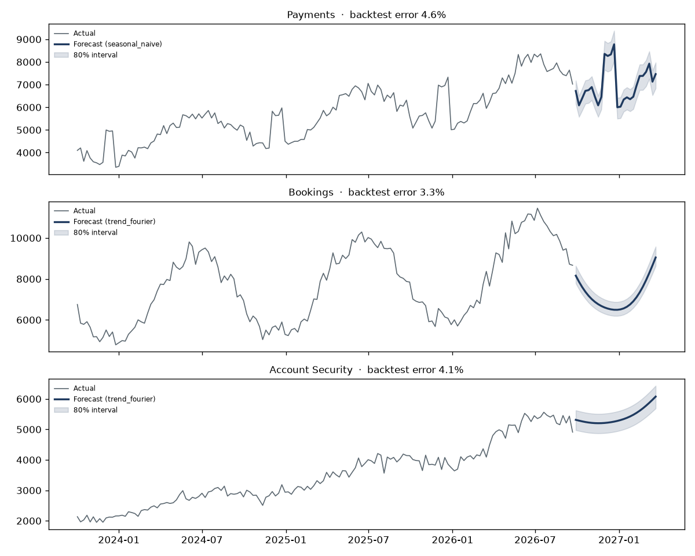
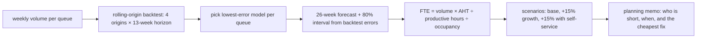

# Forecasting & Scenario Planning

[](https://github.com/Saigwe/forecasting-scenario-planning/actions/workflows/ci.yml)
 

> **Headline:** cover next quarter's pressure point by **cross-training 5 agents and hiring 1**, not a hiring wave. Self-service that trims handle time 10% is worth **15 FTE** if growth runs 15% above forecast.

Demand forecasting turned into a staffing decision. Three support queues, three years of weekly history, four candidate models chosen per queue by back-testing, prediction intervals from real back-test errors, and a scenario planner that converts volume into headcount.



## Pipeline



## Models and accuracy

| Model | Idea |
|---|---|
| Seasonal naive | Same week last year × year-on-year growth. The honest baseline every model must beat. |
| Moving average | Last 8 weeks flat. Shows what ignoring seasonality costs. |
| Holt-Winters | Damped trend with multiplicative yearly seasonality |
| Trend + Fourier | Log-linear trend plus 3 yearly harmonics, fitted on the last 2 years |

Selected models average **3.3–4.6% error** (WAPE) on 13-week-ahead back-tests, against 8–20% for a moving average. Full results: [`output/backtest_accuracy.csv`](output/backtest_accuracy.csv).

## From forecast to decision

The capacity plan doesn't simply add up each queue's peak, because queues peak at different times. Instead it finds the most stretched queue at its own peak week, checks who has spare capacity in that same week, and recommends cross-training before hiring. Assumptions (37.5-hour week, 30% shrinkage, 80% occupancy) are explicit constants in [`planning.py`](forecasting/planning.py).

The memo is [`output/planning_memo.md`](output/planning_memo.md).

## Run it

```bash
pip install -r requirements.txt
python -m forecasting.run     # writes the memo, chart, forecast.csv and backtest_accuracy.csv
pytest
```

## Stack

Python, pandas, NumPy, statsmodels (Holt-Winters), matplotlib, pytest.
