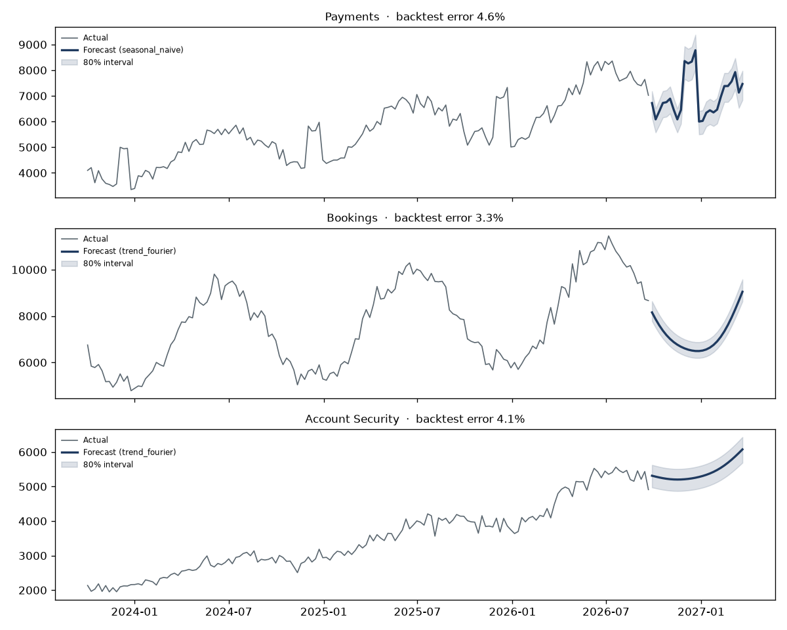

# Support capacity plan: next 26 weeks

**Bottom line:** today's workload needs **134 FTE**, and the total requirement over the next 26 weeks stays
between **106 and 133 FTE**. The pressure point is **Account Security**: in the week of
**22 March 2027** it needs **+6 FTE** over today, while **Bookings** needs
**-5** that same week.

**Decisions needed:**
1. **Cross-train 5 Bookings agents to cover Account Security** before March, using spare capacity rather than new hires.
   Hire 1 more FTE now (lead time about 8 weeks).
2. **Fund self-service as the growth hedge.** If volume runs 15% above forecast the peak needs
   **153 FTE**; cutting handle time 10% brings that to **137**, worth
   **15 FTE** that we would otherwise have to hire.

## By queue

| Queue | FTE needed now | Peak FTE: Base forecast | Peak FTE: Growth +15% | Peak FTE: Growth +15% with self-service (-10% AHT) | Peak week | Model (backtest error) |
|---|---|---|---|---|---|---|
| Payments | 43.1 | 48.8 | 56.1 | 50.5 | 2026-12-21 | seasonal_naive (4.6%) |
| Bookings | 48.2 | 43.1 | 49.5 | 44.6 | 2027-03-22 | trend_fourier (3.3%) |
| Account Security | 42.4 | 48.2 | 55.5 | 49.9 | 2027-03-22 | trend_fourier (4.1%) |

## How far to trust it

Each queue's model was chosen by backtesting: refit at 4 past points and forecast 13 weeks ahead each time. The
selected models average **4.0% error**, against 4.9% for a "same week last year" baseline. The
shaded band in the chart is an 80% interval built from those real backtest errors.

*Assumptions: 37.5-hour week, 30% shrinkage, 80% target occupancy. FTE figures are workload-based; an Erlang C model
per interval would refine them for service-level targets.*
